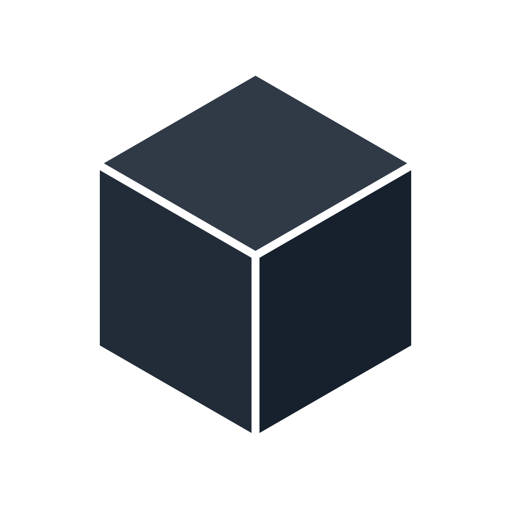

<p align="center">
  <picture>
    <source media="(prefers-color-scheme: dark)" srcset="assets/logo-light.svg">
    <source media="(prefers-color-scheme: light)" srcset="assets/logo-dark.svg">
    
  </picture>
</p>

<h1 align="center">Darkbox</h1>

<p align="center">
  <em>The post-apocalyptic file format.</em>
</p>

<p align="center">
  <a href="docs/specification.md"></a>
  <a href="schema/manifest.schema.json"></a>
</p>

<p align="center">
  <strong>ZIP container &middot; SQLite databases &middot; JSON manifest &middot; Included documentation</strong>
</p>

<p align="center">
  A universal specification and an offline verification tool for project files, designed to keep your work understandable and accessible even when the application that created it is no longer available.
</p>

<p align="center">
  <a href="https://illegal.studio/en/products/darkbox"><strong>Darkbox on illegal.studio</strong></a>
</p>

---

The common specification governs packaging and metadata. Application profiles define their own database schemas, resource conventions, data versions and migrations. Applications keep their own filename extensions. Darkbox does not require applications to share a data model.

## Why Darkbox exists

Darkbox was conceived by Vincenzo Petrucci as a common project-file format for software developed by [Illegal Studio](https://illegal.studio). It is a universal specification that other applications can also adopt.

A person's work should remain accessible beyond the lifetime of the software used to create it. Darkbox aims to make project files understandable and recoverable with documented, widely available tools, even when the original application is no longer available. Documentation travels with each file to help preserve the knowledge needed to interpret its contents.

Closed, undocumented formats can make people dependent on a particular application or vendor to access their own work, limiting their freedom to inspect, preserve, move and reuse what they have created. Darkbox is built on the principle that users' rights over their own creations should not depend on the continued existence of the software used to make them.

Preserving data also means preserving how to decode it. Every archive carries three levels of documentation: the Darkbox README for the container, the original SQLite file-format reference for the database's physical bytes, and the application profile for the meaning of its tables, records and resources. That knowledge travels with the project so it can remain useful beyond the software and websites that originally explained it.

## Documents

- [Specification](docs/specification.md): the current common version, 1.6.0. Every version is retained in [`specification/`](specification/).
- [Canonical Darkbox 1.6.0 README](archive/1.6.0/README.md), copied byte-for-byte to the archive root as `README.md`
- [Rust CLI: installation, commands and reports](docs/cli.md)
- [Rust SDK: reading, editing, SQLite, protection and atomic saving](docs/sdk.md)
- [Low-level library: verification, extension registration and progressive creation](docs/library.md)
- [Offline causal synchronization](docs/sync.md)
- [Application profile guidance](docs/profiles.md)
- [Example manifests](examples/README.md) for two fictional application profiles
- [Conformance corpus](conformance/README.md): valid, invalid and unsupported packages with their expected outcome, for any implementation
- [Manifest JSON Schema](schema/manifest.schema.json) and [canonical bundle catalog schema](schema/bundle.schema.json), using JSON Schema Draft 2020-12
- [Original SQLite file-format reference](archive/1.6.0/docs/sqlite/fileformat2.html), included with its [source and distribution notes](archive/1.6.0/docs/sqlite/SOURCE.md)
- [Changelog](CHANGELOG.md) and [security policy](SECURITY.md)

## What Darkbox defines

The common specification is deliberately small: a ZIP container (or a directory with exactly the same contents), a JSON manifest, self-contained SQLite snapshots, declared resource folders and the documentation needed to read all of it without the original application. Around that core it defines:

| Capability | Since | Summary |
| --- | --- | --- |
| Directory packages and incremental transfers | 1.2.0 | The same tree as a quiescent directory, an optional unsigned inventory and delta transfers between complete editions |
| Coordinated live directories | 1.3.0 | An interoperable lock for working storage, a distinct not-quiescent outcome, sealing and application-trusted digests |
| Retained hot captures | 1.4.0 | A coherent snapshot under a short write barrier while the application keeps working |
| Separate extension bundles | 1.6.0 | Documentation of an official extension travels in its own canonical bundle, only in packages that declare it |

Official extensions are optional and versioned on their own:

| Extension | Versions | Summary |
| --- | --- | --- |
| [Protection](extensions/studio.illegal.darkbox.protection/1.0.0/docs/darkbox/protection/1.0.0.md) | 1.0.0 | Selective AES-256-GCM encryption of attachments and SQLite values, an Ed25519 manifest signature and a signed SHA-256 inventory of every payload file |
| [Synchronization](docs/sync.md) | 1.0.0 (common 1.5.0), 1.1.0 (common 1.6.0 and later) | Offline causal replication through a shared folder, with explicit merge rules, complete checkpoints and bounded retention |

A reader supports exact specification versions. Published versions and their canonical bundles are immutable, and this implementation keeps reading all of them.

## Version numbers

Darkbox has several independent version numbers, because a file format must outlive the software that writes it. A number always belongs to one of these subjects:

| Subject | Where it appears | What it tells you |
| --- | --- | --- |
| Specification | `darkbox.version` in a manifest | The exact common rules a package follows |
| Extension | `extensions.<namespace>.version` in a manifest | The rules of one optional official extension |
| Software | `darkbox --version`, the crate version | The command-line tool and Rust API in use |
| Application data format | `application.formatVersion` in a manifest | The application's own schema, defined by its profile |

They never imply one another: software 1.6.0 and specification 1.6.0 are unrelated. Each software release reads every specification version published before it:

| Software | Specification versions | Protection extension | Sync extension |
| --- | --- | --- | --- |
| 1.0.0 | 1.0.0 | | |
| 1.1.0 | 1.0.0 to 1.1.0 | 1.0.0 | |
| 1.2.0 | 1.0.0 to 1.2.0 | 1.0.0 | |
| 1.3.0, 1.3.1 | 1.0.0 to 1.3.0 | 1.0.0 | |
| 1.4.0 to 1.4.2 | 1.0.0 to 1.4.0 | 1.0.0 | |
| 1.5.0 to 1.6.2 | 1.0.0 to 1.5.0 | 1.0.0 | 1.0.0 |
| 2.0.0 and later | 1.0.0 to 1.6.0 | 1.0.0 | 1.0.0 and 1.1.0 |

Reading and writing are separate. Every release keeps reading and verifying all published specification versions, and keeps saving packages that already use them. From software 3.0.0, new packages are created only in the current versions: **1.6.0**, and **1.5.0** for existing sync 1.0.0 domains. Versions 1.0.0 to 1.4.0 are read-only for new packages, so an application starting today deals with one version, not seven.

Protection 1.0.0 can be declared with specification 1.1.0 and later. Sync 1.0.0 requires specification 1.5.0 exactly; sync 1.1.0 requires specification 1.6.0 or later. `darkbox versions` prints what an installed binary supports.

Two smaller numbers are internal to one artifact each: the delta transfer envelope (`darkboxDelta`, currently 1.0.0) and the JSON report of the command-line tool (`report_version`, currently 2).

## Command-line tool

The `darkbox` binary verifies and inspects archives offline. SQLite and all supported Darkbox references are included; the original application is not required.

```sh
darkbox verify example.project
darkbox inspect example.project
darkbox verify example.project --json
darkbox versions
```

Verification checks common container rules, the exact canonical documentation and SQLite snapshots offline. It reports application-profile semantics as unchecked; passing these common checks does not certify full application conformance. Inspection reports metadata without certifying conformance. `pack`, `unpack`, `delta` and `merge` convert between ZIP and directory packages and build or apply incremental transfers. See the [CLI documentation](docs/cli.md) for reports, exit codes, resource limits and binary packages.

## Install

### Rust SDK (crates.io)

Add the published [darkbox crate](https://crates.io/crates/darkbox) to your project:

```toml
[dependencies]
darkbox = { version = "3.0.1", default-features = false }
```

This selects the SDK without the CLI or extended JSON precision. Enable
`exact-numbers` explicitly if the application needs arbitrary JSON numbers;
otherwise unsupported precision is reported instead of silently rounding values.
See [embedding the SDK](docs/sdk.md) for features, SQLite and integration examples.

To compile and install the CLI through Cargo, with Rust 1.89 or later and a C compiler:

```sh
cargo install darkbox --locked
```

### Homebrew

```bash
brew install illegalstudio/tap/darkbox
```

### pacman (Arch Linux)

Enable the [Illegal Studio pacman repository](https://github.com/illegalstudio/pacman#install) by adding this section to `/etc/pacman.conf`:

```ini
[illegalstudio]
SigLevel = Optional TrustAll
Server = https://illegalstudio.github.io/pacman/$arch
```

Then install Darkbox together with a full system update:

```bash
sudo pacman -Syu darkbox
```

The repository serves x86-64 and ARM64 packages. Packages follow its existing unsigned distribution policy and preserve Darkbox's dependency notices.

### mise

```bash
mise use -g github:illegalstudio/darkbox
```

To pin a software version, append it: `mise use -g github:illegalstudio/darkbox@<version>`.

### GitHub Releases

Download the package for your platform from [GitHub Releases](https://github.com/illegalstudio/darkbox/releases), together with its `.sha256` file. Replace `<version>` with the CLI software version.

| Platform | Package |
| --- | --- |
| Linux x86-64 | `darkbox_<version>_linux_amd64.tar.gz` |
| Linux ARM64 | `darkbox_<version>_linux_arm64.tar.gz` |
| macOS ARM64 (Apple Silicon) | `darkbox_<version>_darwin_arm64.zip` |

Check the download with `sha256sum -c <package>.sha256` on Linux or `shasum -a 256 -c <package>.sha256` on macOS. Extract the package and put its `darkbox` executable in a directory on your `PATH`. Linux packages require glibc 2.35 or later; macOS packages target macOS 11 or later. Packages include documentation and dependency license notices.

### From source

With Rust 1.89 or later and a C compiler:

```bash
cargo install --path . --locked
```

## Versioned archive documentation

The entire `archive/<darkbox.version>/` directory is the canonical documentation bundle for that version. Copy all its contents into the ZIP root, preserving every relative path and file's bytes. Do not add an enclosing `archive/` or version directory inside the ZIP. Then add the manifest, application profile documentation, databases and resources at their declared paths.

For version `1.6.0`, the [bundle](archive/1.6.0/) contains the canonical README, its [SHA-256 catalog](archive/1.6.0/docs/darkbox/bundle.json), the directory and delta rules, and the captured SQLite documentation under `docs/sqlite/`, including its local presentation assets and upstream public-domain notice. Select the directory matching the declared version, rather than automatically using the newest bundle or fetching current SQLite pages while saving a project.

From 1.6.0, documentation of official extensions is separate. Each extension version has its own canonical bundle in `extensions/<namespace>/<version>/`, with its own catalog, copied into the ZIP root in the same way only when the manifest declares that extension. A package that declares no official extension carries only the common bundle. Versions 1.1.0 through 1.5.0 carried the extension documentation inside the common bundle.

Published version directories are retained unchanged. Each release provides the matching specification and manifest schema together with its complete canonical bundle. Darkbox-authored text uses LF; `.gitattributes` protects both its line endings and the exact captured upstream bytes from checkout conversion.

Versioned specifications are retained in `specification/<version>.md` and manifest schemas in `schema/<version>/`. [`versions.json`](versions.json) registers every supported version, its capabilities and the extension bundles. The main documentation links show the current version; the CLI selects references by the exact declared version.

## Minimal archive

```text
example.project
├── manifest.json
├── README.md
├── docs/
│   ├── profile.md
│   ├── darkbox/          # canonical catalog and common Darkbox documents
│   └── sqlite/           # complete canonical SQLite reference bundle
└── data/
    └── project.sqlite
```

Darkbox fixes its root metadata names and canonical bundle paths. Other database and folder paths are declared in the manifest. Required `application.profilePath` locates the included application data-format documentation; `docs/profile.md` is a recommended path. Attachments may remain database BLOBs or become separate files, as defined by a profile.

The current specification is identified by `darkbox.version = "1.6.0"`. It is independent of the application data-format version and of the optional creator-software version, as described under [version numbers](#version-numbers).

## License

The Rust implementation, specification, schema, Darkbox-authored documentation, examples and Darkbox logo assets are licensed under the [MIT License](LICENSE). The original SQLite materials retain their upstream terms, recorded in the included [SQLite copyright notice](archive/1.6.0/docs/sqlite/copyright.html) and [source notes](archive/1.6.0/docs/sqlite/SOURCE.md). The license does not change ownership or licensing of project data packaged by applications. The canonical README includes the full MIT notice so it travels with distributed files. Permission to modify Darkbox materials does not alter conformance requirements, including the exact canonical bundle.
