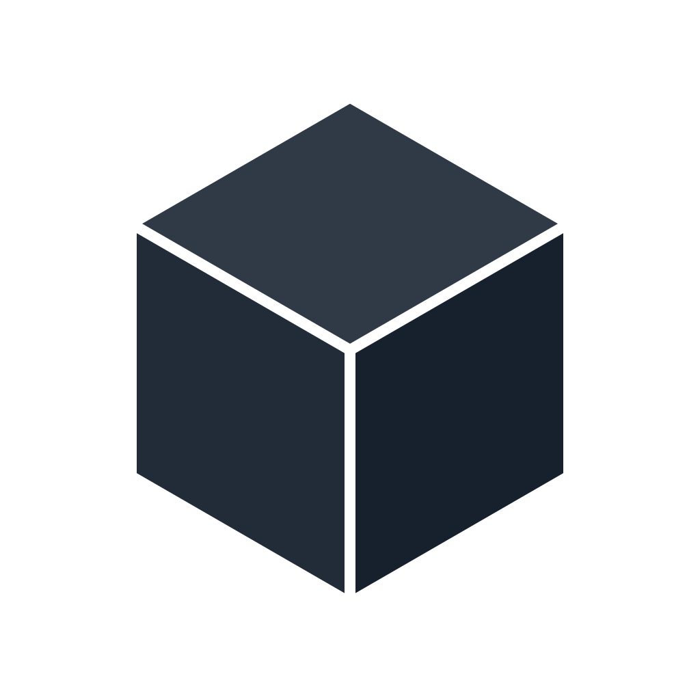

<p align="center">
  <picture>
    <source media="(prefers-color-scheme: dark)" srcset="assets/logo-light.svg">
    <source media="(prefers-color-scheme: light)" srcset="assets/logo-dark.svg">
    
  </picture>
</p>

<h1 align="center">Darkbox</h1>

<p align="center">
  <em>The post-apocalyptic file format.</em>
</p>

<p align="center">
  <a href="docs/specification.md"></a>
  <a href="schema/manifest.schema.json"></a>
</p>

<p align="center">
  <strong>ZIP container &middot; SQLite databases &middot; JSON manifest &middot; Included documentation</strong>
</p>

<p align="center">
  A universal specification for project files, designed to keep your work understandable and accessible even when the application that created it is no longer available.
</p>

<p align="center">
  <a href="https://illegal.studio/en/products/darkbox"><strong>Darkbox on illegal.studio</strong></a>
</p>

---

The common specification governs packaging and metadata. Application profiles define their own database schemas, resource conventions, data versions and migrations. Applications keep their own filename extensions. Darkbox does not require applications to share a data model.

## Why Darkbox exists

Darkbox was conceived by Vincenzo Petrucci as a common project-file format for software developed by [Illegal Studio](https://illegal.studio). It is a universal specification that other applications can also adopt.

A person's work should remain accessible beyond the lifetime of the software used to create it. Darkbox aims to make project files understandable and recoverable with documented, widely available tools, even when the original application is no longer available. Documentation travels with each file to help preserve the knowledge needed to interpret its contents.

Closed, undocumented formats can make people dependent on a particular application or vendor to access their own work, limiting their freedom to inspect, preserve, move and reuse what they have created. Darkbox is built on the principle that users' rights over their own creations should not depend on the continued existence of the software used to make them.

## Documents

- [Specification](docs/specification.md)
- [Canonical Darkbox 1.0.0 README](archive/1.0.0/README.md), copied byte-for-byte to the archive root as `README.md`
- [Manifest JSON Schema](schema/manifest.schema.json), using JSON Schema Draft 2020-12
- [Example manifests](examples/README.md) for two fictional application profiles
- [Application profile guidance](docs/profiles.md)

## Versioned archive documentation

Canonical archive READMEs are stored under `archive/<darkbox.version>/README.md`. For version `1.0.0`, download or copy [archive/1.0.0/README.md](archive/1.0.0/README.md) and include those exact bytes at the ZIP root. Select the directory matching the declared version, rather than automatically using the newest README.

Published version directories are retained unchanged. Each release provides the matching specification and manifest schema together with its canonical README. Repository text files use LF, enforced by `.gitattributes`, so checkout line-ending conversion cannot alter the canonical file.

## Minimal archive

```text
example.project
├── manifest.json
├── README.md
├── docs/
│   └── profile.md
└── data/
    └── project.sqlite
```

Only the root metadata names are fixed by Darkbox. Database and folder paths are declared in the manifest. Required `application.profilePath` locates the included application data-format documentation; `docs/profile.md` is a recommended path. Attachments may remain database BLOBs or become separate files, as defined by a profile.

The specification version, application data-format version and optional creator-software version are independent. This version of the specification is identified by `darkbox.version = "1.0.0"`. Application profiles define their own data-format versions.

## License

The specification, schema, documentation, examples and logo assets are licensed under the [MIT License](LICENSE). The license covers Darkbox materials; it does not change ownership or licensing of project data packaged by applications. The canonical archive README includes the full license notice so it travels with distributed files. Permission to modify these materials does not alter Darkbox conformance requirements, including the exact canonical README.
